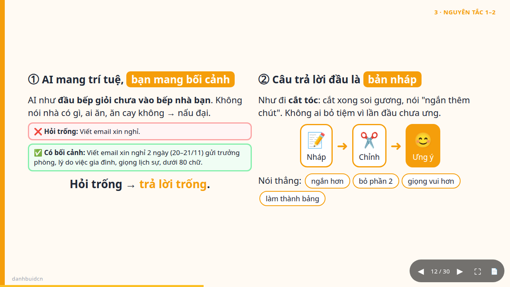
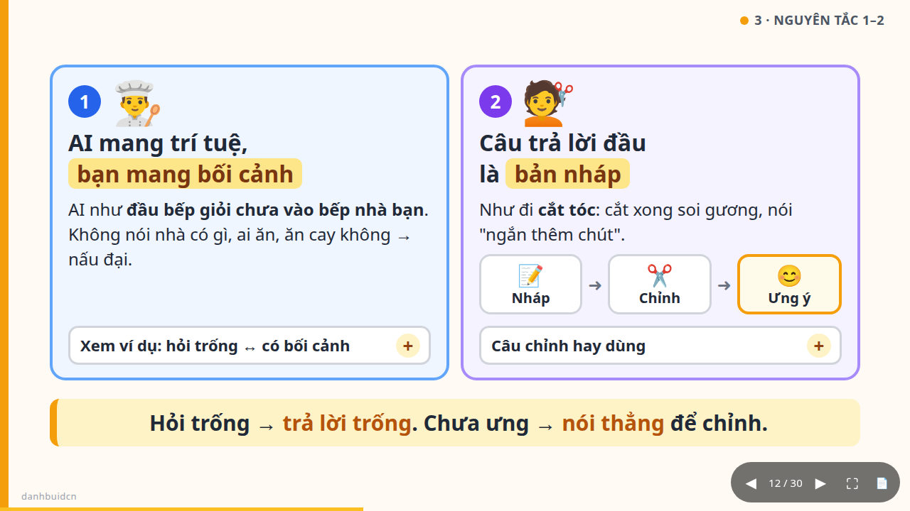

# Thiết kế lại slide: đẹp và chỉ rõ chỗ cần tập trung
Nhánh: .
Phụ thuộc: 3_interactive-practice-and-ai-map.md
## Input
Owner (2026-11-19), xem slide 12 (nguyên tắc 1–2): đóng vai designer, thiết kế không chỉ đẹp mà còn để học viên biết nên tập trung vào đâu.
## Context
- Vấn đề nhìn thấy ở slide 12: 2 cột cùng cỡ chữ, cùng độ nổi → mắt không biết nhìn đâu trước; nhiều vùng trống phía trên/dưới, chữ nhỏ so với khung; nhãn ①② nhỏ; ví dụ "Hỏi trống / Có bối cảnh" và câu chốt "Hỏi trống → trả lời trống" gần như cùng trọng lượng; 4 nút "Nói thẳng" kéo mắt xuống cuối.
- Nguyên tắc thiết kế chung cho cả bộ (áp mọi slide):
  1. Mỗi slide có đúng 1 ý chính → hiện to nhất, đặt ở vị trí mắt nhìn đầu tiên (trên-trái hoặc giữa). Có thể thấy rõ khi nheo mắt/giảm sáng.
  2. Thứ bậc 3 mức: ý chính (rất to, đậm) → ví dụ/bằng chứng (vừa) → chú thích (nhỏ, nhạt). Bỏ mức thứ 4.
  3. Màu có nghĩa cố định: xanh lá = nên làm/đúng, đỏ = tránh, vàng/cam = chỗ cần nhấn/hành động, xanh dương = bạn nhập, xám = phụ. Mỗi slide tối đa 2 màu nhấn.
  4. Chữ nhấn (tô đậm/tô màu) chỉ dùng cho từ khoá cần nhớ, không quá 2–3 chỗ/slide.
  5. Câu cần nhớ (chốt) nằm riêng 1 dải/khung ở cuối, cỡ lớn, tách rõ khỏi phần giải thích.
  6. Slide có 2 cột: cột chính (rộng, nổi) và cột phụ, hoặc xếp trên-dưới theo thứ tự đọc có số; không 2 khối bằng nhau tranh nhau.
  7. Tận dụng khoảng trống: tăng cỡ chữ nội dung (ngồi cuối phòng vẫn đọc được), căn khối giữa theo chiều dọc, không để nửa trống nửa chật.
  8. Hình khối/biểu tượng phục vụ ý chính (so sánh, quy trình, trước-sau), không trang trí thừa. Quy trình dùng mũi tên rõ, bước hiện tại/đích nổi bật.
  9. Slide thực hành: nhãn ① Bạn nhập / ② Kết quả to, nút hành động (Gửi) là thứ nổi nhất.
  10. Đủ tương phản chữ/nền (đạt WCAG AA), cỡ chữ tối thiểu 18px trên khung 1280×720.
- Owner (slide 13, nguyên tắc 3–5): quá nhiều chữ cùng lúc. Dùng **bấm để mở**: hiện sẵn chỉ đầu mục (tiêu đề + 1 hình/biểu tượng + 1 câu rất ngắn), bấm vào mới hiện chi tiết (ví dụ, giải thích). Áp dụng cho mọi slide có nhiều khối chữ (không chỉ slide 13) để tăng tương tác. Quy định:
  - Thẻ chưa mở trông rõ là bấm được (mũi tên/dấu "+", con trỏ tay, viền đổi màu khi rê chuột).
  - Bấm lần nữa để đóng; mở 1 thẻ thì thẻ khác thu lại (hoặc cho mở nhiều, chọn cách hợp từng slide).
  - Có thể bấm bằng bàn phím (Tab/Enter) và điện thoại. Phím ←/→ vẫn chuyển slide.
  - Khi in PDF: mở hết tất cả thẻ.
  - Ghi 1 dòng nhỏ "Bấm vào từng ô để xem thêm" ở slide dùng kiểu này lần đầu.
  - Câu chốt (ý cần nhớ) luôn hiện sẵn, không giấu.
- Owner (slide 14, "Viết lại câu trả lời đầu"): bài thực hành phải **so sánh rõ ràng** để học viên NHÌN là thấy khác biệt. Ví dụ: prompt 1 "Viết thông báo cho phụ huynh về buổi họp lớp." → AI trả về; prompt 2 áp dụng đủ công thức (vai trò, bối cảnh, việc cần làm, kết quả mong muốn, hỏi lại nếu chưa rõ) → AI trả về. Hai kết quả đặt cạnh nhau.
  - Kiểu "so sánh 2 cột" dùng chung (trong `ai.js` + CSS): cột trái "Lần 1: hỏi ngắn" (đỏ/xám), cột phải "Lần 2: có công thức" (xanh lá); mỗi cột có ① prompt (nhập được) và ② kết quả. 1 nút "So sánh" chạy cả 2 cùng lúc.
  - Phía trên hai cột: 1 dòng câu hỏi dẫn mắt "Nhìn xem: 2 kết quả khác nhau ở đâu?"; dưới cột phải: gợi ý 2–3 điểm nên nhìn (ví dụ: có ghi giờ họp? có đúng giọng? độ dài?) dạng ô bấm để mở.
  - Prompt công thức ở cột phải tô màu từng phần (vai trò / bối cảnh / việc / kết quả mong muốn / hỏi lại) để học viên thấy phần nào tạo nên khác biệt.
  - Áp dụng cho mọi bài có tính chất "trước/sau": slide 14, bài công thức prompt (phần 4), bài đưa tài liệu/bối cảnh, bài đặt khung trả lời cuối buổi (trước và sau khi đặt khung). Bài nào chỉ 1 lần chạy thì giữ ① ②.
  - Học viên không phải tự đọc dài: kết quả dài thì cắt gọn ở đầu và có nút "xem hết"; dòng tóm khác biệt (ví dụ "Lần 2: có giờ họp, dưới 60 chữ, giọng thân thiện") do trang tự ghi sẵn dưới 2 cột (ghi cố định, không nhờ AI chấm).
  - Cùng prompt chạy lại có thể ra kết quả khác nhau: ghi 1 câu "AI có thể khác mỗi lần, quan trọng là xu hướng" và có nút "Chạy lại".
- Owner (slide 23, phần 5 Tài liệu): 2 nội dung khác nhau ("File yêu cầu cố định" và "Project") đặt cạnh nhau nhưng nhìn như 1 khối, lộn xộn. Luật: **mỗi khái niệm = 1 thẻ riêng** để học viên nhìn là biết 2 thứ khác nhau.
  - Mỗi thẻ: nền/viền màu riêng (khác nhau rõ), 1 biểu tượng lớn, tên thẻ cỡ lớn, 1 câu "nó là gì" bằng hình ảnh đời thường, 1 dòng "dùng khi nào". Chi tiết (cách làm, bảng, prompt mẫu) giấu trong "bấm để mở" của từng thẻ.
  - Giữa 2 thẻ có chữ nối rõ quan hệ (ví dụ "hoặc" / "cách dễ" vs "cách mạnh hơn") để biết nên chọn cái nào trước.
  - Slide 23: thẻ 1 "Tờ giấy dán tủ lạnh (file yêu cầu cố định)" — cách dễ, ai cũng làm được; thẻ 2 "Tủ tài liệu (Project/Gem)" — cách mạnh hơn, tuỳ app. Bảng ChatGPT/Gemini/NotebookLM ở trong thẻ 2 khi bấm mở.
  - Áp dụng luật "mỗi khái niệm một thẻ" cho mọi slide đặt cạnh nhau 2+ ý khác nhau (vd slide 9 bản đồ AI, slide 12–13).
- Không đổi nội dung/ý nghĩa, không tăng số slide (≤ 30), không đụng `ai.js` logic/key.
## Plan
- [x] Chụp ảnh toàn bộ slide hiện tại (Chrome headless, 1280×720), xem từng slide, ghi bảng: slide → mắt nhìn đâu trước? → vấn đề → cách sửa — xong (2026-11-19 16:45): ảnh ở `/tmp/aw4/before/`, bảng ở mục "Bảng rà slide" bên dưới. Đổi thứ tự: làm hệ thống thiết kế trước (2 thành phần dùng nó).
- [x] Thiết lập hệ thống thiết kế chung (cỡ chữ 3 mức, bảng màu có nghĩa, khoảng cách, khung chốt) trong CSS, dùng chung — xong (2026-11-19 17:05): `index.html` `<style>` có ghi chú đầu: 3 mức (h2 40px / nội dung 22–24px / chú thích `.cap` 18px), biến màu `--hi` cam, `--good`, `--bad`, `--you` xanh dương; màu phần chỉ còn ở vạch trái + chấm nhãn; `.chot` (dải chốt), `.act` (dải hành động), `.flow` (quy trình có số), `.concepts/.concept kA/kB/kC` (mỗi khái niệm 1 thẻ), `.card.side` (thẻ phụ). Slide cuộn được khi dài (`justify-content: safe center`). `ai.css`: ① xanh dương nét đứt, nút Gửi cam to nhất, ② xám; chữ trên slide ≥ 18px.
- [x] Làm thành phần "bấm để mở" dùng chung (CSS trong `ai.css` + JS trong `ai.js`); áp cho slide 13 trước, rồi mọi slide nhiều chữ — xong (2026-11-19 17:20): `AI.folds()` + `.fold > button.fold-h + .fold-b`; nút "+" đổi "−", viền cam khi rê chuột; `data-one` = mở 1 thẻ thì thẻ khác thu lại; `.foldrow` = hàng thẻ, chi tiết hiện thành dải rộng dưới hàng (không đẩy lệch thẻ); in: mở hết. Phím: Enter/Space mở-đóng khi đang chọn nút, ←/→ vẫn chuyển slide. Slide 13 đã dùng (thử Chrome: Enter mở ③, bấm ④ thì ③ đóng, Space đóng, → sang slide 14, 0 lỗi JS). Các slide khác làm ở bước "Thiết kế lại".
- [x] Làm thành phần "so sánh 2 cột" dùng chung, áp cho slide 14 và các bài trước/sau (17, 19, 24, 29) — xong (2026-11-19 17:45): `AI.compare('.ai-cmp')` trong `ai.js` (+ CSS `ai.css`): câu dẫn "👀 Nhìn xem: 2 kết quả khác nhau ở đâu?", cột trái ❌ đỏ / phải ✅ xanh lá, mỗi cột ① (sửa được, 📋 Chép) và ② (kết quả dài cắt gọn + "Xem hết ▾"), 1 nút cam "So sánh ➜" gửi cả 2 cùng lúc → đổi thành "🔄 Chạy lại", dòng tóm khác biệt ghi sẵn (`data-sum`), ô "nên nhìn" bấm để mở, câu "AI có thể khác mỗi lần…". Prompt phải tô màu 5 phần (`span.pp1…pp5`) + chú giải màu. Nhiều bộ (`.cmp-set`) → nút chọn (slide 17: 3 nghề). Áp: slide 14 (thông báo họp phụ huynh), 17 (3 nghề), 19 (câu ngắn của bạn ↔ công thức, còn [ ] thì nhắc), 24 (không đưa ↔ dán quy định nghỉ phép; cách B bấm để mở), 29 + phiếu 7 (khung thử: cùng câu hỏi, không có ↔ có Phần A; dòng tóm theo mẫu). Thử Chrome + máy trung gian giả: gửi đúng 2 câu, nút thành "Chạy lại", kết quả dài có "Xem hết", slide 19 còn [ ] không gửi, 0 lỗi JS. Vạch màu trái giờ đứng yên khi cuộn.
- [x] Thiết kế lại từng slide theo 10 nguyên tắc; làm slide 12 trước làm mẫu rồi áp các slide còn lại — xong (2026-11-19 18:20): slide 12 mẫu = 2 thẻ ① xanh dương / ② tím, mỗi thẻ có số, hình lớn, tên lớn, 1 câu ví von; ví dụ và câu chỉnh bấm để mở; dải chốt "Hỏi trống → trả lời trống. Chưa ưng → nói thẳng để chỉnh." Áp tiếp: 2 (thẻ chính/phụ + quy trình + chốt), 3 (7 phần thành quy trình có số), 4 (3 bước có mũi tên → thẻ đích), 5 (cột "cá" cam, chốt "máy đoán chữ"), 6 ("khác" thay "≠"), 7 (thẻ chính rộng), 9 (4 thẻ app bấm để mở + dòng "Bấm vào từng ô để xem thêm" + Codex/Claude Code thành 1 ô phụ), 11 (chữ to hơn, "≠" → "khác"), 13, 15, 16 (5 màu phần, khớp màu tô prompt), 18, 20 (2 bước có số, 3 cách bấm để mở), 21 (2 thẻ Gmail/Drive, Excel; chi tiết bấm để mở), 22, 23 (thẻ "Tờ giấy dán tủ lạnh" ↔ "Tủ tài liệu" + "hoặc"), 25, 26, 28 (chốt thành dải). In PDF: script `beforeprint` mở hết ô, slide dài thu nhỏ vừa 1 trang (`--z`). Tương phản: chữ nhạt đổi `#5f6672` (≥ 5.2:1), cột xám slide 5 `#6b7280`.
- [x] Làm tương tự phần phiếu (`handouts/index.html`) ở mức vừa đủ (thứ bậc + màu có nghĩa) — xong (2026-11-19 18:35): tên phiếu 28px, mục h3 có vạch màu phần, ghi chú xám; tab đang mở nền đen chữ trắng (trước: chữ trắng trên màu phần, thiếu tương phản); ô "tự ghi" viền xanh dương nét đứt (= bạn nhập); `.tip` thành dải cam. Khung ①② tự đổi màu theo `ai.css`. Phiếu 4: khung 5 phần thành so sánh câu ngắn ↔ công thức tô màu (giống slide 19); phiếu 7: khung thử so sánh không có/có Phần A. Đầu trang thêm 1 dòng giải thích khung so sánh. Thử Chrome: phiếu 4 còn [ ] → nhắc, không gửi; in 16 trang; 0 lỗi JS.
- [x] Kiểm tra: chụp lại, bài "nheo mắt" (làm mờ ảnh: ý chính còn đọc được không), không tràn chữ, in PDF ≤ 30 trang, không lỗi JS, commit (không push) — xong (2026-11-19 18:45): Chrome 1280×720 chụp lại 30 slide; làm mờ 4px ở nửa cỡ: còn thấy rõ tiêu đề, dải chốt cam, thẻ có số, nút Gửi cam. Chữ < 18px trên slide: 0 chỗ (trước: 12–17px ở 28 slide). Tràn ngang: chỉ thẻ "Gemini trả lời dài" slide 26 (cố ý cắt mờ). Slide dài (thực hành 8, 10, 14, 16, 17, 19, 24, 27, 29) cuộn được. In PDF slide: 30 trang, mọi ô bấm để mở đã mở, 10 slide được thu nhỏ vừa trang; phiếu: 16 trang. Lỗi JS: 0 (slide + phiếu). `grep "AQ\.|AIza"` → 0. Tương phản chữ ≥ 4.5:1 (tính theo WCAG; chỉ chữ ký "danhbuidcn" mờ trang trí là thấp).
- [x] Ghi bảng trước/sau vào Kết quả, kèm ảnh slide 12 trước/sau trong `wip/2026-11-19/img/` — xong (2026-11-19 18:50): `img/4_slide12-truoc.png`, `img/4_slide12-sau.png`, `img/4_slide12-sau-mo-vi-du.png`; bảng ở `## Kết quả`.
### Bảng rà slide (trước khi sửa, 2026-11-19 16:45)
Lỗi chung: chữ phụ 12–17px (nhãn ①②, ghi chú, thẻ "Dùng khi"); màu phần (đỏ phần 4, hồng phần 7) dùng tô thẻ chính → đỏ bị hiểu là "tránh"; chữ trắng trên vàng/cam không đủ tương phản; dấu "≠" hiện "=/" (slide 6, 13); câu chốt cùng cỡ với chữ thường.
| Slide | Mắt nhìn đâu trước | Vấn đề | Cách sửa |
|---|---|---|---|
| 1 | Tiêu đề | Ổn | Giữ |
| 2 | 2 thẻ bằng nhau | Chữ nhỏ 19px, khung trống nửa dưới | Thẻ "Học xong, bạn biết" chính (rộng), "Dành cho ai" phụ; câu chốt thành dải |
| 3 | 7 thẻ nhỏ | 7 thẻ + 3 thẻ cùng trọng lượng | 7 phần thành dải quy trình có số; 3 lời dặn thành hàng nhỏ; chốt thành dải |
| 4 | 4 thẻ bằng nhau | Thẻ ý chính (AI nhớ chữ nào đi sau chữ nào) không nổi hơn | 3 thẻ nhỏ đánh số có mũi tên → thẻ đích nổi |
| 5 | Câu "Con mèo…" | Chữ giải thích nhỏ, chốt chìm | Tăng cỡ; câu "máy đoán chữ" thành dải chốt |
| 6 | Con vẹt | "≠" lỗi, thẻ nhỏ, xanh/đỏ sai nghĩa | Thẻ to, xám → cam; chữ "khác"; chốt dải |
| 7 | Thẻ xanh | 2 thẻ bằng nhau | Thẻ "AI tạo nội dung" chính (rộng, viền cam), thẻ kia phụ xám |
| 8, 10 | Các bước | Nhãn ①② 16px, ghi chú 12px | Hệ thống chung: ① xanh dương, nút Gửi cam nổi nhất, chữ ≥18px |
| 9 | 4 thẻ app | Chữ 17px, 2 thẻ Codex/Claude Code chen ngang | Thẻ app: tên to + "dùng khi"; chi tiết bấm để mở; Codex/Claude Code thành 1 ô phụ bấm để mở; chốt dải |
| 11 | Bàn tay | Chữ ngón tay 16–19px | Tăng cỡ |
| 12 | 2 cột bằng nhau | Như owner tả | Mẫu: 2 thẻ có số ①②, màu riêng, hình + 1 câu; ví dụ và câu chỉnh bấm để mở; dải chốt |
| 13 | 3 khối chữ dày | Quá nhiều chữ | 3 thẻ đầu mục, chi tiết bấm để mở; dải chốt |
| 14 | Các bước | Kết quả 2 lần nằm trên-dưới, phải cuộn | So sánh 2 cột (owner tả) |
| 15 | 2 thẻ | Ổn, chữ nhỏ | Tăng cỡ, thẻ màu riêng, dải chốt |
| 16 | Thẻ đỏ "Hỏi lại" | Đỏ sai nghĩa | 5 thẻ màu theo 5 phần (dùng lại ở prompt tô màu slide 14, 19); không tô đỏ |
| 17 | 3 cột ① ② | 3 bộ ①② nhỏ, phải cuộn | So sánh 2 cột + 3 nút chọn nghề |
| 18 | Thẻ đỏ | Đỏ sai nghĩa | Thẻ thường, thẻ "Chịu trách nhiệm" viền cam |
| 19 | Các bước | Chỉ 1 lần chạy | So sánh: câu ngắn của bạn ↔ công thức tô màu |
| 20 | 3 thẻ | Bước 1/Bước 2 lẫn | 2 bước có số; 3 cách: tên + "Free", cách làm bấm để mở |
| 21 | 2 cột chữ dày | Rất nhiều chữ | 2 thẻ (Gmail/Drive, Excel), chi tiết bấm để mở |
| 22 | 4 thẻ đỏ | Ổn (đỏ = tránh) | Tăng cỡ; chốt dải |
| 23 | 2 cột | Như owner tả | 2 thẻ "Tờ giấy dán tủ lạnh" / "Tủ tài liệu" + chữ nối |
| 24 | Các bước | Dài, phải cuộn | So sánh: không đưa tài liệu ↔ có dán tài liệu; cách B, C bấm để mở |
| 25 | 4 thẻ | Chốt chìm | Tăng cỡ, dải chốt, dải hành động cam |
| 26–27 | Khung ① | Ổn | Theo hệ thống chung |
| 28 | Thẻ hồng | Màu phần làm nhấn | Thẻ "Khung trả lời" cam; dải chốt |
| 29 | Khung thử | Chỉ 1 kết quả | Kết quả 2 cột: không có hướng dẫn ↔ có hướng dẫn Phần A |
| 30 | Tiêu đề | Ổn | Tăng cỡ |

## Kết quả
### Slide 12 trước / sau
| Trước | Sau |
|---|---|
|  |  |

Bấm "Xem ví dụ": [img/4_slide12-sau-mo-vi-du.png](img/4_slide12-sau-mo-vi-du.png)

### Bảng trước / sau (toàn bộ)
| Chỗ | Trước | Sau |
|---|---|---|
| Cỡ chữ | 4–5 mức, chữ phụ 12–17px | 3 mức: ý chính 40px (dải chốt 30px) → nội dung 22–24px → chú thích 18px; không chỗ nào < 18px trên slide |
| Màu | Màu phần tô thẻ (đỏ phần 4 = "tránh", hồng phần 7) | Màu có nghĩa: cam = nhấn/hành động, xanh lá/đỏ = nên/tránh, xanh dương = bạn nhập, xám = phụ; màu phần chỉ còn vạch trái + chấm nhãn |
| Câu chốt | Chữ đậm cùng cỡ, lẫn vào phần giải thích | Dải cam riêng ở cuối, 30px (slide 2, 3, 5, 6, 9, 12, 13, 15, 22, 25, 26, 28) |
| Nhiều khối chữ | Hiện hết cùng lúc | Bấm để mở (slide 9, 12, 13, 20, 21, 23, 24); câu chốt luôn hiện; in thì mở hết |
| 2 ý cạnh nhau | 2 cột bằng nhau, nhìn như 1 khối | Mỗi khái niệm 1 thẻ màu riêng, hình lớn, tên lớn, 1 câu ví von, "dùng khi" (12, 15, 21, 23 + chữ nối "hoặc") |
| Quy trình | Thẻ rời, không thứ tự | Bước có số + mũi tên, đích viền cam (2, 3, 4, 12) |
| Bài trước/sau | 2 khung ①② nằm trên-dưới, phải cuộn tìm | So sánh 2 cột ❌/✅, 1 nút "So sánh", dòng tóm khác biệt, "Chạy lại" (14, 17, 19, 24, 29, phiếu 4, 7) |
| Khung thực hành | ① viền vàng, ② viền tím, nhãn 16px | ① xanh dương nét đứt, nút Gửi cam to nhất, ② xám; nhãn 20px |
| In PDF | 30 trang, slide dài bị cắt | 30 trang, slide dài thu nhỏ vừa trang, ô bấm để mở đã mở |

### Đã đổi
- `index.html`: CSS hệ thống thiết kế (ghi chú đầu `<style>`), 25/30 slide sắp lại; phím Space/Enter trên nút không chuyển slide; in: mở hết + thu nhỏ slide dài.
- `ai.js`: thêm `AI.folds()` (bấm để mở), `AI.compare()` (so sánh 2 cột), khung thử `lab()` so sánh không có/có Phần A; thêm `sum` cho 5 mẫu. Không đổi máy trung gian, key, cách gọi Gemini (`ask`).
- `ai.css`: màu ①② mới, CSS bấm để mở, so sánh 2 cột, tô màu 5 phần prompt.
- `handouts/index.html`: thứ bậc + màu, phiếu 4 so sánh, chữ hướng dẫn khung thử.

### Quyết định worker tự chọn
- Màu phần (xanh, đỏ, hồng…) chỉ giữ ở vạch trái + chấm nhãn để học viên biết đang ở phần nào; không tô thẻ nữa (tránh đỏ bị hiểu là "sai").
- Thẻ khái niệm dùng 3 màu nền nhận diện (xanh dương, tím, xanh ngọc), không tính là "màu nhấn"; slide 14/17/19 tô 5 màu cho 5 phần prompt theo yêu cầu owner (vượt quy tắc "tối đa 2 màu nhấn", có chú giải màu).
- Hàng thẻ bấm để mở (`.foldrow`, slide 9, 13, 20): mở 1 thẻ thì thẻ khác thu lại, chi tiết hiện thành dải rộng dưới hàng (thẻ không bị kéo lệch). Thẻ khái niệm (12, 21, 23): mở nhiều ô cùng lúc được.
- Ô "nên nhìn" của so sánh đặt dưới cả 2 cột (không chỉ dưới cột phải) để 3 ô nằm 1 hàng, gọn hơn.
- Dòng tóm khác biệt hiện sẵn từ đầu (owner: "ghi sẵn").
- Slide 14: bài "câu chỉnh trong cùng cuộc trò chuyện" đổi thành so sánh hỏi ngắn ↔ công thức (theo owner); phiếu 3 vẫn giữ bài câu chỉnh nối tiếp + danh sách câu chỉnh hay dùng.
- Slide 24: bài "tóm tắt đoạn dán" đổi thành so sánh không đưa ↔ dán quy định nghỉ phép (ví dụ cố định 14 ngày để thấy rõ AI đoán vs AI đọc); cách B vào ô bấm để mở.
- Slide 13 và 23 thêm tiêu đề ngắn ("3 nguyên tắc còn lại", "Để AI luôn nhớ yêu cầu của bạn") để có ý chính ở vị trí nhìn đầu.
- In PDF: dùng `beforeprint` + biến `--z` (thu nhỏ) thay vì cho slide dài tràn sang trang 2, để giữ 30 trang.

### Còn lại
- Chưa gọi Gemini thật cho so sánh 2 cột (đã thử bằng máy trung gian giả; mỗi lần "So sánh" tốn 2 lượt, giới hạn 5 lượt/phút/trình duyệt → bấm tối đa 2 lần/phút). Owner nên bấm thử 1 lần trên trang thật sau khi đẩy lên GitHub.
- Nhãn "⬇ Cuộn xuống xem tiếp" cập nhật mỗi 0,4 giây nên có thể hiện thoáng qua khi vừa chuyển slide (có từ trước, chưa sửa).
- README không cần sửa. `outline/03`, `04`, `05`, `07` đã sửa phần thực hành cho khớp khung so sánh.
